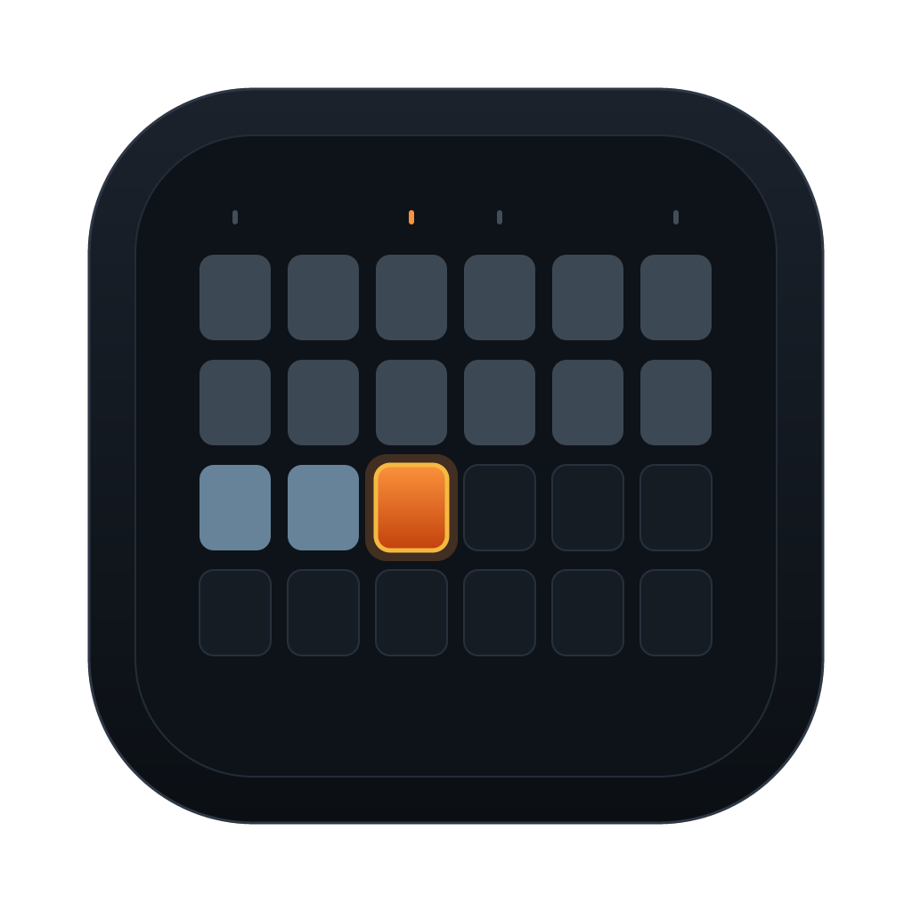

<p align="center">
  
</p>

# Block Clock

A native desktop clock that renders the day as a 24×60 grid of 1,440 minute blocks. Built with Rust and [GPUI](https://gpui.rs/).

**Website:** https://aungmyokyaw.github.io/block-clock/ · **Releases:** https://github.com/AungMyoKyaw/block-clock/releases/latest

## Features

- **1,440 minute blocks** — One block per minute of the day. Elapsed hours, earlier minutes in the current hour, the active minute, and upcoming minutes are visually distinct.
- **Minute inspector** — Click any block or navigate with the keyboard to inspect its time, state, and block index (`Block N / 1440`) without disturbing the live clock.
- **Day progress & timezone** — Right rail displays current block index, elapsed percentage, progress bar, IANA timezone, and DST indicator.
- **Native window controls** — Always-on-top pin (macOS and Windows), fullscreen toggle, and settings modal with System / Light / Dark theme and 24-hour / 12-hour time format.
- **Responsive layout** — Stacks the inspector rail below the grid on narrow windows (`< 760px`).
- **Persistent preferences** — Saves theme, time format, pin state, and window bounds to your OS config directory (`block-clock/settings.json`).

## Build & Run

```bash
# Development
make dev

# Release binary
make build

# macOS .app bundle (target/release/Block Clock.app)
make bundle

# Format, clippy, and tests
make check
make test
```

## Keyboard Shortcuts

- `⌘/Ctrl + P` — Toggle always-on-top pin (macOS and Windows)
- `⌘/Ctrl + Shift + F` — Toggle fullscreen
- `⌘/Ctrl + ,` — Open settings
- `J` — Jump to current minute
- `Arrow keys` / `Home` / `End` — Move minute selection across the grid
- `Esc` — Close settings, exit fullscreen, or clear selection
- `⌘ + Q` — Quit (macOS)

## License

PolyForm Noncommercial License 1.0.0. See [LICENSE](LICENSE).
